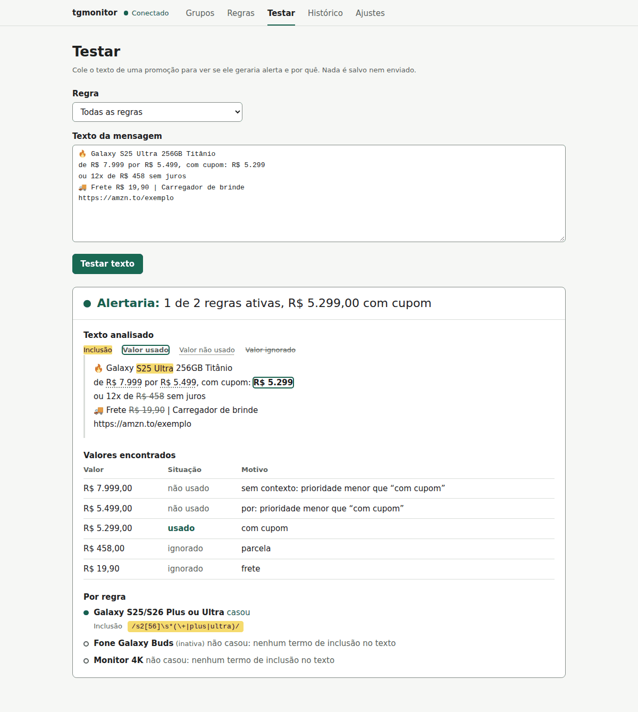
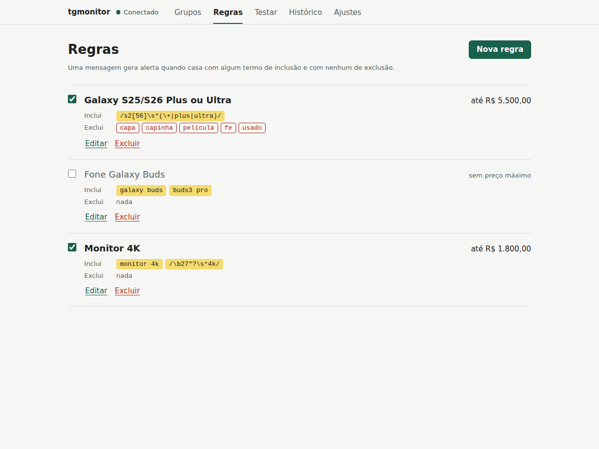
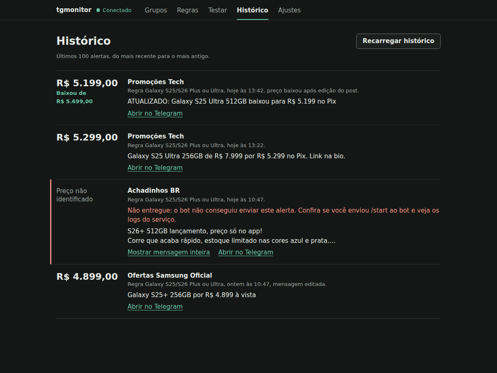
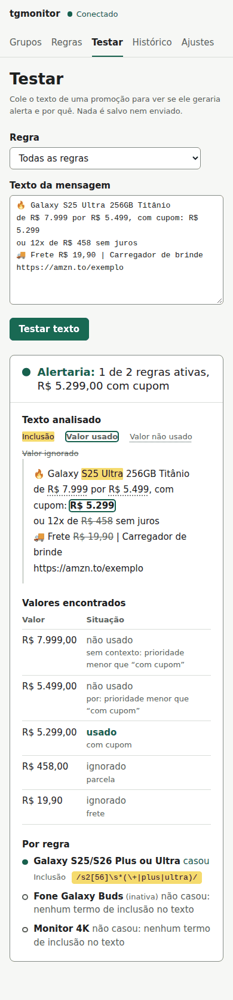

# telegram-monitor

Monitor pessoal de promoções no Telegram. Ele lê os grupos e canais em que a **sua
conta** já participa e manda uma mensagem para você, por um bot, quando aparece uma
promoção que casa com as suas regras. Exemplo: *"Galaxy S25 ou S26, Plus ou Ultra, até
R$ 5.500, sem capa nem película"*.



**Para quem é:** quem acompanha grupos de ofertas e quer ser avisado só do que importa.
Não é preciso saber programar. Os passos abaixo levam uma pessoa sem experiência com
servidores do zero até o monitor rodando 24 horas por dia.

**O que faz**

- Escuta mensagens novas e editadas **só nos grupos que você marcar**.
- Aplica regras com termos de inclusão e exclusão (texto simples ou regex, sem acento e
  sem diferenciar maiúsculas) e um preço máximo opcional.
- Extrai o preço da mensagem, ignorando parcelas, cupons, frete e cashback.
- Não alerta a mesma promoção duas vezes. Se um post já alertado for editado com
  **preço menor**, avisa de novo: "Preço baixou: de R$ 5.499,00 para R$ 4.999,00".
- Tem uma tela web de configuração (grupos, regras, teste de regra e histórico).
- Reconecta sozinho, avisa pelo bot se cair repetidamente e aceita um "heartbeat"
  externo que avisa se a máquina desligar.

**O que não faz (limitações)**

- **Não envia nada nos grupos.** Só lê. Também não entra em grupos por você: ele só vê
  os chats em que a sua conta já está.
- **Não lê imagens.** Promoções publicadas só como foto, sem texto, passam despercebidas.
- **A extração de preço é heurística.** Ela acerta os formatos comuns ("de R$ X por
  R$ Y", "com cupom", "no Pix", parcelas), mas pode errar em textos incomuns. Quando não
  tem certeza, o alerta chega marcado com "preço não identificado", em vez de ser descartado.
- **Precisa de uma máquina ligada 24 horas.** Se ela desligar, as mensagens do período
  não são alertadas. Ao voltar, o monitor ignora mensagens com mais de 3 horas, para não
  avisar de promoções vencidas.
- É **para uso pessoal**: um monitor por conta do Telegram, com um único dono do bot.

> ⚠️ **Sobre usar a sua conta com um programa ("userbot").** A API do Telegram permite
> isso, mas abuso pode levar a limitações na conta. Este projeto faz o uso de menor
> risco: só lê mensagens de chats em que você já está. Use por sua conta e risco.

---

## Sumário

1. [Segurança: leia antes de tudo](#1-segurança-leia-antes-de-tudo)
2. [Pré-requisitos](#2-pré-requisitos)
3. [Credenciais: Telegram e bot](#3-credenciais-telegram-e-bot)
4. [Início rápido no seu computador](#4-início-rápido-no-seu-computador)
5. [Escrevendo regras](#5-escrevendo-regras)
6. [Rodando 24 horas: hospedagem](#6-rodando-24-horas-hospedagem)
7. [Oracle Cloud: custos e cuidados](#7-oracle-cloud-custos-e-cuidados)
8. [Uso no dia a dia](#8-uso-no-dia-a-dia)
9. [Solução de problemas](#9-solução-de-problemas)
10. [Para agentes de IA](#10-para-agentes-de-ia)
11. [Como funciona por dentro](#11-como-funciona-por-dentro)

---

## 1. Segurança: leia antes de tudo

Você vai lidar com quatro segredos. Qualquer um deles nas mãos de outra pessoa dá
acesso à sua conta ou ao seu bot.

| Segredo | O que permite | Onde fica |
|---|---|---|
| `TG_API_HASH` (e `TG_API_ID`) | Identifica o seu "aplicativo" no Telegram | `.env` |
| Código de login (chega no app do Telegram) | Entrar na sua conta | Só é digitado uma vez, no terminal |
| Arquivo de sessão (`account.session`) | **Usar a sua conta sem senha nem código** | Pasta de dados, com permissão 600 |
| `BOT_TOKEN` | Controlar o seu bot | `.env` |

**Nunca cole** o `.env`, o token do bot, o `api_hash`, o código de login ou o arquivo de
sessão em chats, prints, issues do GitHub, fóruns ou conversas com IA. O Telegram nunca
pede o seu código de login por mensagem: quem pede é golpista.

**Se algo vazar:**

- **Token do bot:** no [@BotFather](https://t.me/BotFather), envie `/revoke`, escolha o
  bot e troque o `BOT_TOKEN` no `.env` pelo novo.
- **Sessão ou código de login:** no app do Telegram, vá em **Configurações >
  Dispositivos** e encerre a sessão "tgmonitor" (ou todas as outras). Depois refaça o
  login com `tgmonitor login`.
- **`api_hash`:** em <https://my.telegram.org>, apague o app e crie outro.

**O que o projeto garante:**

- A tela web só escuta em `127.0.0.1` (fixo no código) e exige o `API_TOKEN`. Ela aceita
  só os endereços `127.0.0.1` e `localhost`, o que bloqueia ataques de *DNS rebinding*.
- O bot só responde ao seu `OWNER_USER_ID` e ignora qualquer outra pessoa.
- Nenhum texto de mensagem vai para serviços externos, e os logs têm só números (ids e
  contadores).
- O programa nunca envia, encaminha, edita ou apaga mensagens com a sua conta. Um teste
  automático (`tests/test_readonly.py`) falha se alguém tentar.
- O login é feito **só** pelo terminal. Não existe login pela web.

---

## 2. Pré-requisitos

| Item | Observação |
|---|---|
| Conta no Telegram | A sua conta pessoal, com o app instalado no celular (para receber o código de login). |
| **Python 3.12 ou mais novo** | Já vem no Ubuntu 24.04. Confira com `python3 --version`. |
| **`python3.12-venv`** (Ubuntu/Debian) | Sem ele, criar o ambiente virtual falha com erro de `ensurepip`. Instale com `sudo apt install -y python3.12-venv`. |
| `git` | Para baixar o projeto: `sudo apt install -y git`. |
| Conta na Oracle Cloud (opcional) | Só para deixar rodando 24 horas de graça. Veja a [seção 6](#6-rodando-24-horas-hospedagem). |

### Windows: use o WSL

O projeto roda em Linux. No Windows 10 ou 11, use o **WSL** (um Ubuntu dentro do Windows):

1. Abra o **PowerShell como administrador** e rode:

   ```powershell
   wsl --install -d Ubuntu-24.04
   ```

2. Reinicie o computador se ele pedir, abra "Ubuntu" no menu Iniciar e crie um usuário e
   uma senha para o Linux.
3. Para entrar no WSL **já dentro da pasta do projeto**, abra o PowerShell na pasta
   (no Explorador de Arquivos: clique com o botão direito dentro da pasta >
   *Abrir no Terminal*) e digite:

   ```powershell
   wsl
   ```

   O prompt muda para algo como `usuario@PC:/mnt/c/Users/voce/telegram-monitor$`. Daqui em
   diante, todos os comandos são digitados nesse terminal Linux.

> No WSL, uma pasta `C:\...` do Windows aparece como `/mnt/c/...`. Funciona, mas é mais
> lento. Se preferir, clone o projeto direto no Linux (`cd ~ && git clone ...`).

---

## 3. Credenciais: Telegram e bot

Você vai juntar cinco valores para o arquivo `.env`: `TG_API_ID`, `TG_API_HASH`,
`BOT_TOKEN`, `OWNER_USER_ID` e `API_TOKEN` (este último é gerado por um comando).

### 3.1 `TG_API_ID` e `TG_API_HASH` (my.telegram.org)

1. Acesse <https://my.telegram.org> e informe o **seu** número com código do país
   (ex: `+5511999999999`). O código de confirmação chega **no app do Telegram**, não por SMS.
2. Clique em **API development tools**.
3. Preencha o formulário *Create new application*:
   - **App title:** `tgmonitor` (qualquer nome serve)
   - **Short name:** `tgmonitor` (de 5 a 32 letras ou números)
   - **URL:** deixe em branco
   - **Platform:** marque **Other** ("Outro")
   - **Description:** é **obrigatória**. Escreva algo como "Monitor pessoal de promoções".
4. Clique em **Create application**.
5. Anote o **App api_id** (um número) e o **App api_hash** (32 letras e números).

**Não mexa** nas seções de notificações push (**FCM**, **WNS**) nem na lista de
servidores **MTProto** que aparecem na mesma página. Elas não são usadas por este projeto.

> Se aparecer só "ERROR" ao criar, a causa mais comum é o **Short name**: confira se tem
> entre 5 e 32 caracteres, só letras minúsculas e números, sem espaço, hífen ou acento
> (ex: troque por `tgmonitor2` ou `meutgmonitor`). Se persistir, tente outro navegador ou
> desative extensões de bloqueio.

### 3.2 `BOT_TOKEN` (BotFather)

1. No Telegram, abra o **[@BotFather](https://t.me/BotFather)**. Confira que é o oficial:
   ele tem o selo azul de verificado.
2. Envie `/newbot`, escolha um nome (ex: "Meus alertas") e um username que termine em
   `bot` (ex: `meus_alertas_bot`).
3. Ele responde com o **token**, algo como `123456789:AAH...`. Esse é o `BOT_TOKEN`.
4. Ainda no BotFather, envie `/setjoingroups`, escolha o seu bot e depois **Disable**.
   Assim ninguém consegue colocar o seu bot em grupos.
5. **Abra o seu bot** (pelo link `t.me/seu_bot` que o BotFather mostrou) e envie
   **`/start`**. Sem isso, o Telegram não deixa o bot mandar mensagens para você, e todo
   alerta falha com erro 403.

### 3.3 `OWNER_USER_ID` (o seu id numérico)

1. Abra o **[@userinfobot](https://t.me/userinfobot)**. Cuidado com as imitações:
   confira que o username é exatamente `@userinfobot`.
2. Envie qualquer mensagem. Ele responde com o seu **Id**, um número como `123456789`.

Esse bot só precisa ler o seu id. **Nunca** mande para ele, nem para outro bot, o código
de login, o token ou qualquer outra credencial.

---

## 4. Início rápido no seu computador

Faça isto primeiro no seu computador (Linux, macOS ou WSL), para ver tudo funcionando
antes de colocar num servidor. Rode os comandos **na ordem**. Em cada passo está o que
deve aparecer quando dá certo.

**1. Baixar o projeto e criar o ambiente**

```bash
git clone https://github.com/CaioViniciusPF/telegram-monitor.git
cd telegram-monitor
python3 -m venv .venv
source .venv/bin/activate
pip install -e .
```

O prompt passa a começar com `(.venv)`, e o último comando termina com
`Successfully installed ... tgmonitor-0.1.0`. Se `python3 -m venv` falhar falando de
`ensurepip`, instale o `python3.12-venv` (veja a [seção 9](#9-solução-de-problemas)).

> Toda vez que abrir um terminal novo, entre na pasta e rode `source .venv/bin/activate`
> antes de usar o comando `tgmonitor`.

**2. Criar o `.env`**

```bash
cp .env.example .env
chmod 600 .env
tgmonitor gen-token
```

O último comando imprime um texto aleatório com cerca de 43 caracteres. Abra o `.env`
(`nano .env`) e preencha:

```ini
TG_API_ID=12345678
TG_API_HASH=0123456789abcdef0123456789abcdef
BOT_TOKEN=123456789:AAH...
OWNER_USER_ID=123456789
API_TOKEN=cole-aqui-o-texto-do-gen-token
```

(Esses valores são exemplos. Use os seus.) No `nano`: `Ctrl+O`, `Enter` para salvar e
`Ctrl+X` para sair.

**3. Conferir a configuração**

```bash
tgmonitor check-config
```

Antes do login, o esperado é tudo OK, exceto a sessão:

```text
Configuração carregada.
  DATA_DIR       /home/voce/.local/share/telegram-monitor  [não existe]
  sessão         /home/voce/.local/share/telegram-monitor/account.session  [não existe]
  banco          /home/voce/.local/share/telegram-monitor/monitor.db  [não existe]
  OWNER_USER_ID  123456789
  web            http://127.0.0.1:8000
  heartbeat      desativado
  bot            @meus_alertas_bot OK
  telegram       sem sessão: rode `tgmonitor login`
```

Se a linha `bot` mostrar `ERRO: Unauthorized`, o `BOT_TOKEN` está errado.

**4. Fazer login com a sua conta (só uma vez)**

```bash
tgmonitor login
```

As perguntas aparecem em inglês, porque vêm da biblioteca Telethon:

```text
Please enter your phone (or bot token): +5511999999999
Please enter the code you received: 12345
Please enter your password:            <- só se você tiver verificação em duas etapas
OK: sessão salva para Seu Nome em /home/voce/.local/share/telegram-monitor/account.session (permissão 600).
```

O código chega **no app do Telegram**, numa conversa com "Telegram". Digite o código
**só aqui**, no terminal.

Rode `tgmonitor check-config` de novo. Agora a linha `telegram` deve mostrar
`sessão autorizada`.

**5. Iniciar o monitor**

```bash
tgmonitor run
```

Deve aparecer, entre outras linhas:

```text
... INFO tgmonitor.service: tgmonitor iniciado; interface em http://127.0.0.1:8000
... INFO tgmonitor.supervisor: listener conectado
```

Deixe esse terminal aberto (fechar ou `Ctrl+C` para o monitor).

**6. Abrir a tela de configuração**

No navegador, acesse **<http://127.0.0.1:8000>**. A tela pede o `API_TOKEN` (o mesmo do
`.env`). Depois:

1. **Grupos:** marque os grupos e canais que quer monitorar. Na primeira execução a
   lista carrega sozinha. Se estiver vazia, clique em **Atualizar grupos**.
2. **Regras:** clique em **Nova regra** (veja a [seção 5](#5-escrevendo-regras)).
3. **Testar:** cole o texto de uma promoção antiga e confira se a regra casaria.

Pronto: quando chegar uma mensagem que casa, o seu bot manda o alerta.

---

## 5. Escrevendo regras

Cada regra tem:

- **Termos de inclusão** (obrigatório): um por linha. **Basta um casar.**
- **Termos de exclusão** (opcional): um por linha. Se **qualquer** um aparecer, a
  mensagem é descartada.
- **Preço máximo** (opcional): acima dele, a mensagem é descartada.

**Exclusões e preço máximo são opcionais.** Deixados em branco, não descartam nada. Na
dúvida, o monitor alerta: se a regra tem preço máximo mas o preço não foi identificado,
o alerta chega mesmo assim, marcado com "⚠️ preço não identificado".

### Exemplo amplo (só inclusão)

Avisa de qualquer menção. Bom para começar e ver o que aparece.

| Campo | Valor |
|---|---|
| Nome | `Galaxy S25` |
| Inclusão | `galaxy s25` |
| Exclusão | *(vazio)* |
| Preço máximo | *(vazio)* |

### Exemplo restrito

Só modelos Plus e Ultra do S25 e do S26, novos, até R$ 5.500, sem acessórios.

| Campo | Valor |
|---|---|
| Nome | `Galaxy S25/S26 Plus ou Ultra` |
| Inclusão | `/s2[56]\s*(\+\|plus\|ultra)/` |
| Exclusão | `capa`, `capinha`, `película`, `fe`, `usado`, `seminovo`, `vitrine` (um por linha) |
| Preço máximo | `5.500,00` |



### Como os termos casam

- **Termo simples** casa por **palavra inteira**, sem acento e sem diferenciar
  maiúsculas:

  | Termo | Casa com | Não casa com |
  |---|---|---|
  | `fe` | "S25 **FE**" | "per**fe**ito", "ca**fé**" |
  | `película` | "**PELICULA**", "**Película**" | |
  | `s25 ultra` | "**S25   Ultra**" (qualquer espaço) | "S25Ultra" |
  | `s25+` | "Galaxy **S25+**" | "S255" |

- **Regex** vai entre barras e é aplicada ao texto já sem acento e em minúsculas. O
  exemplo `/s2[56]\s*(\+|plus|ultra)/` casa com "S25+", "S25 Plus", "S26 Ultra" e
  variações.

Use sempre a aba **Testar** (ou "Testar este rascunho", dentro do formulário da regra).
Ela mostra o texto com os termos destacados, cada valor em R$ classificado (usado, não
usado ou ignorado, e por quê) e a decisão final.

### Como o preço é escolhido

Cada valor `R$ ...` é classificado pelo contexto:

| Prioridade | Tipo | Exemplos |
|---|---|---|
| 1 | Preço final | `com cupom: R$ 5.299`, `com desconto R$ 5.199`, `no Pix R$ 5.199`, `à vista R$ 5.199`, `R$ 5.199 no Pix` |
| 2 | "por" | `por R$ 5.499`, `agora R$ 5.499` |
| 3 | Sem contexto | qualquer outro |
| ignorado | Não é o preço | `12x de R$ 458`, `cupom de R$ 200`, `R$ 200 OFF`, `R$ 300 de desconto`, `frete R$ 19,90`, `cashback de R$ 100` |

O preço usado é o **menor valor do tipo de maior prioridade**. Exemplo: em
`de R$ 5.999 por R$ 5.499, com cupom: R$ 5.299`, o preço é **R$ 5.299**.

### Repetições e edições

- O **mesmo post** nunca gera dois alertas, **exceto** quando é editado e o preço
  **baixa** (e a regra continua casando). Aí chega "📉 Preço baixou: de X para Y".
- A **mesma promoção em outro grupo** é suprimida por 6 horas (ajustável). A comparação
  usa o texto, o link junto com o preço, e as regras casadas junto com o preço. Um link
  igual com **preço menor** gera alerta novo.
- Mensagens com mais de **3 horas** e edições de mensagens com mais de **24 horas** são
  ignoradas.

Todos esses limites ficam na aba **Ajustes**.

---

## 6. Rodando 24 horas: hospedagem

O monitor roda em **qualquer máquina Linux ligada 24 horas**: um PC antigo, um
Raspberry Pi, uma VPS de outra empresa ou uma VM na nuvem. Ele usa cerca de 80 a 120 MB de
RAM. O caminho recomendado e detalhado aqui é a **Oracle Cloud**, que tem uma VM gratuita.
Em outra máquina com Ubuntu 24.04, pule a criação da VM (6.1) e siga **a partir da
instalação (6.2)**: os passos são os mesmos.

### 6.1 Criar a VM gratuita na Oracle

> Leia a [seção 7](#7-oracle-cloud-custos-e-cuidados) **antes** de criar a conta. Ela
> explica o que é gratuito, quando o cartão pode ser cobrado e o que não tocar.

O console da Oracle muda de tempos em tempos, então esta seção diz **o que a VM precisa
ter**, aponta o tutorial oficial e, por último, mostra como foi feito em setembro de 2026.
Se a tela estiver diferente, siga a lista de requisitos.

#### O que a VM precisa ter

| Item | Valor |
|---|---|
| Região | A sua **região home** (ex: *Brazil East (Sao Paulo)*). VMs gratuitas só podem ser criadas nela, e ela não pode ser trocada depois. |
| Imagem | **Canonical Ubuntu 24.04**, a versão padrão (não *Minimal* nem *aarch64*) |
| Shape | **VM.Standard.E2.1.Micro** (AMD, 1 GB de RAM), com o rótulo **Always Free-eligible** |
| Rede | Uma VCN com **sub-rede pública** e um **IPv4 público** atribuído à VM |
| Acesso | Uma **chave SSH**. Só a porta 22 aberta, que já é o padrão |
| Disco | O volume de boot padrão, sem volumes extras |

#### Tutorial oficial

A Oracle mantém o tutorial
[Launching Your First Linux Instance](https://docs.oracle.com/en-us/iaas/Content/GSG/Reference/overviewworkflow.htm),
que cria a rede e depois a VM, na mesma ordem usada aqui. **Não siga** duas partes dele:
a de criar e anexar um *block volume* (não é necessário) e a de apagar os recursos no
final (ela apagaria a sua VM).

#### Pegadinhas conhecidas

- **Login no console em três etapas:** primeiro o *Cloud Account Name* (o nome da sua
  tenancy, não o e-mail), depois o *identity domain* **Default**, e só então e-mail e senha.
- **Conta nova não tem rede.** Criar a rede pela tela da VM pode travar (o botão do IPv4
  público não libera). Crie a rede antes, pelo assistente de VCN.
- **A imagem padrão pode não ser a 24.04.** Confira antes de criar.
- **"View estimated cost" mostra um valor**, como R$ 10/mês pelo volume de boot. Essa
  estimativa usa o preço de tabela e ignora a cota gratuita. O volume padrão está dentro
  dos 200 GB gratuitos.
- **A chave SSH baixada pode ir para outra pasta.** Confira onde o navegador salvou
  (`Ctrl+J`). No WSL, copie a chave para `~/.ssh` antes do `chmod 600`, que não funciona
  em pastas do Windows (`/mnt/c`, `/mnt/d`). Nunca deixe a chave dentro da pasta do projeto.

Se a tela estiver diferente do que está aqui, mandar prints para um assistente de IA
ajuda bastante. **Nunca** envie a chave privada, senhas, o `.env` ou códigos de login.

<details>
<summary><strong>Como foi feito em setembro de 2026</strong> (a interface pode ter mudado)</summary>

**1. Criar a rede**

1. Menu **☰ > Networking > Virtual cloud networks > Start VCN Wizard** (ou, na página
   inicial, *Set up a network with a wizard*).
2. Escolha **Create VCN with Internet Connectivity**.
3. Dê um nome (ex: `vcn-telegram-monitor`) e mantenha o resto no padrão: IPv6
   desligado, sub-rede pública `10.0.0.0/24`, sub-rede privada `10.0.1.0/24`.
4. **Next > Create**. A VCN, as sub-redes e os gateways não têm custo.

**2. Criar a VM**

1. Menu **☰ > Compute > Instances > Create instance**.
2. **Image:** *Change image* > **Canonical Ubuntu** > **24.04**.
3. **Shape:** *Change shape* > *Specialty and previous generation* >
   **VM.Standard.E2.1.Micro**. Confira o rótulo **Always Free-eligible**.
4. **Security:** mantenha o padrão (*Shielded instance*). Não ative a computação
   confidencial.
5. **Networking:** *Select existing virtual cloud network*, escolha a VCN criada e a
   sub-rede **pública**. Ative **Automatically assign public IPv4 address**. Deixe o
   IPv6 desligado.
6. **SSH keys:** *Generate a key pair for me* > **Download private key**. Ela não é
   mostrada de novo.
7. **Boot volume:** não mude nada.
8. **Create**. Quando o estado ficar **Running**, copie o **Public IP address**
   (na página da instância, em *Instance access* ou *Primary VNIC*).

**3. Conectar** (no WSL, troque o caminho pelo de onde a chave foi salva):

```bash
mkdir -p ~/.ssh
cp /mnt/c/Users/SEU_USUARIO/Downloads/ssh-key-*.key ~/.ssh/oracle.key
chmod 600 ~/.ssh/oracle.key
ssh -i ~/.ssh/oracle.key ubuntu@IP_DA_VM
sudo apt update && sudo apt -y upgrade
```

Na primeira conexão, responda `yes` à pergunta sobre a autenticidade do servidor. Se o
`apt upgrade` pedir reinício, rode `sudo reboot` e conecte de novo depois de um minuto.

</details>

### 6.2 Instalar o monitor (VM Oracle ou qualquer Ubuntu 24.04)

```bash
sudo git clone https://github.com/CaioViniciusPF/telegram-monitor.git /opt/telegram-monitor
sudo bash /opt/telegram-monitor/deploy/setup-vm.sh
```

O script pode ser rodado de novo sem problema. Ele:

- instala Python, `python3-venv` e git;
- cria 2 GB de *swap*, que evita falta de memória na VM de 1 GB;
- cria o usuário de sistema `tgmonitor`, a pasta de dados `/var/lib/telegram-monitor`
  (permissão 700) e o ambiente Python em `/opt/telegram-monitor/.venv`;
- cria `/etc/tgmonitor/tgmonitor.env` com um `API_TOKEN` aleatório já preenchido;
- instala e habilita o serviço systemd (reinício automático), sem iniciá-lo;
- instala o atalho `tgmonitor-admin`, que roda os comandos como o usuário do serviço.

Ele termina imprimindo "Pronto. Próximos passos". Continue:

```bash
sudo nano /etc/tgmonitor/tgmonitor.env      # preencha TG_API_ID, TG_API_HASH, BOT_TOKEN, OWNER_USER_ID
sudo tgmonitor-admin check-config           # mesma saída da seção 4, passo 3
sudo tgmonitor-admin login                  # mesmas perguntas da seção 4, passo 4
sudo systemctl start telegram-monitor
journalctl -u telegram-monitor -f           # deve mostrar "listener conectado"; Ctrl+C sai
```

> O login é feito **com o serviço parado**. Se ele já estiver rodando, pare antes com
> `sudo systemctl stop telegram-monitor`.

### 6.3 Acessar a tela pelo túnel SSH

Na VM, a tela **não** fica exposta na internet. Você a acessa por um túnel SSH aberto a
partir do seu computador:

```bash
ssh -i ~/.ssh/oracle.key -N -L 8000:127.0.0.1:8000 ubuntu@IP_DA_VM
```

O comando fica "parado", sem mostrar nada: isso é normal. Deixe-o aberto e acesse
**<http://localhost:8000>** no navegador. Para ver o `API_TOKEN`:

```bash
sudo grep API_TOKEN /etc/tgmonitor/tgmonitor.env      # na VM
```

O token fica só na memória da aba e é pedido de novo quando você recarrega a página.

### 6.4 Aviso se a máquina parar (healthchecks.io)

O bot avisa se o monitor cair repetidamente, mas não tem como avisar se **a máquina
inteira** parar. Para isso existe o heartbeat, que é opcional e gratuito:

1. Crie uma conta em <https://healthchecks.io> e um *Check* com **Period: 5 minutes** e
   **Grace: 10 minutes**.
2. Em *Integrations*, ative e-mail (ou Telegram).
3. Copie a *ping URL* e coloque no `.env` (na VM, em `/etc/tgmonitor/tgmonitor.env`):

   ```ini
   HEALTHCHECK_URL=https://hc-ping.com/seu-uuid
   ```

4. Reinicie: `sudo systemctl restart telegram-monitor`.

O monitor faz uma requisição vazia nessa URL a cada 5 minutos, **só enquanto está
saudável**. Se a máquina desligar ou o monitor travar, os pings param e você recebe o
aviso. Nenhum dado é enviado.

---

## 7. Oracle Cloud: custos e cuidados

As informações abaixo vêm da documentação oficial da Oracle, consultada em setembro de
2026. **As regras podem mudar.** Confira sempre a página atual:
[Always Free Resources](https://docs.oracle.com/en-us/iaas/Content/FreeTier/freetier_topic-Always_Free_Resources.htm).

### Trial e Always Free são coisas diferentes

- **Free Trial:** US$ 300 em créditos, válidos por até 30 dias, para qualquer serviço.
  ([Free Tier](https://docs.oracle.com/en-us/iaas/Content/FreeTier/freetier.htm))
- **Always Free:** um conjunto de recursos que não expira. Inclui até **2 VMs
  VM.Standard.E2.1.Micro** (1/8 de OCPU, **1 GB** de RAM, 1 IP público), **200 GB de disco
  no total** (boot e volumes somados) e 10 TB de tráfego de saída por mês. As VMs só
  podem ser criadas na **região home**.
  ([Always Free Resources](https://docs.oracle.com/en-us/iaas/Content/FreeTier/freetier_topic-Always_Free_Resources.htm))

**Quando o trial acaba** (30 dias ou créditos esgotados, o que vier primeiro), recursos
**pagos** continuam funcionando por 30 dias de carência, mas não dá para criar novos. Se
você não fizer upgrade, eles são recuperados pela Oracle. Os recursos **Always Free**
continuam funcionando. Numa conta gratuita, isso vale **enquanto a conta tiver sido
usada nos últimos 60 dias**: entre no console de vez em quando.
([What Happens When the Promotion Expires](https://docs.oracle.com/en-us/iaas/Content/GSG/Tasks/signingup_topic-What_Happens_When_the_Promotion_Expires.htm))

### Por que pedem cartão, e quando ele pode ser cobrado

A Oracle pede cartão "for security purposes" e afirma que ele **não é cobrado a menos que
você faça upgrade** da conta. Pode aparecer uma pré-autorização temporária, que o banco
estorna. ([Free Tier](https://docs.oracle.com/en-us/iaas/Content/FreeTier/freetier.htm))
No upgrade para Pay As You Go, há uma pré-autorização de US$ 100, também estornada.
([Managing Account Upgrades](https://docs.oracle.com/en-us/iaas/Content/Billing/Tasks/changingpaymentmethod.htm))

### Crie só o que tem o rótulo "Always Free-eligible"

Para este projeto, bastam **a VM E2.1.Micro, a imagem Ubuntu e o volume de boot padrão**,
todos com o rótulo *Always Free-eligible*. **Não faça:**

- **não escolha outros shapes** (qualquer outro tamanho de VM pode ser pago);
- **não crie volumes extras** nem aumente o boot volume sem conferir o limite de 200 GB
  somados;
- **não reserve IP público** (*Reserved Public IP*): use o IP que vem com a VM;
- **não crie** load balancer, banco de dados ou outros serviços "só para testar" durante o
  trial: eles consomem créditos e, depois, podem virar custo;
- **não clique em "Upgrade"** sem querer. O botão aparece com destaque no console.

### A regra das VMs ociosas

A Oracle pode recuperar instâncias Always Free consideradas **ociosas** (critérios
exatos, com CPU, rede e período de 7 dias, na página oficial de
[Always Free Resources](https://docs.oracle.com/en-us/iaas/Content/FreeTier/freetier_topic-Always_Free_Resources.htm#compute)).
Este serviço usa pouca CPU e pouca rede, então **provavelmente se enquadra**. O
heartbeat (seção 6.4) avisa se a VM parar, e aí basta ligá-la de novo no console
(*Instances* > a VM > **Start**). Quem quiser evitar esse risco pode avaliar o upgrade
para **Pay As You Go**, conferindo antes, na documentação da Oracle, as condições e os
possíveis custos de sair do Always Free.

Se decidir fazer o upgrade, ele fica em **Billing & Cost Management > Upgrade and
Manage Payment**
([docs](https://docs.oracle.com/en-us/iaas/Content/Billing/Tasks/changingpaymentmethod.htm)).
Depois de fazer o upgrade, crie **logo em seguida** um alerta de orçamento de US$ 1:

1. Menu **☰ > Billing & Cost Management > Cost Management > Budgets > Create Budget**.
2. **Scope:** *Compartment*, com o compartimento raiz (o nome da sua conta).
3. **Name:** `alerta-1-dolar`. **Schedule:** *Monthly*. **Budget amount:** `1` (US$ 1,
   o mínimo aceito).
4. Em **Budget alert rule**: **Threshold metric** *Actual Spend*, **Threshold type**
   *Percentage of Budget*, **Threshold** `1` (1% de US$ 1, ou seja, avisa já no primeiro
   centavo gasto), e o seu e-mail em **Email recipients**.
5. Clique em **Create**.

Os alertas de orçamento são avaliados a cada 24 horas.
([Creating a Budget](https://docs.oracle.com/en-us/iaas/Content/Billing/Tasks/create-budget.htm),
[Alert Rule](https://docs.oracle.com/en-us/iaas/Content/Billing/Tasks/create-alert-rule.htm))

### Onde conferir se há custo acontecendo

Menu **☰ > Billing & Cost Management > Cost Management > Cost Analysis**. Com só
recursos Always Free, o valor deve ficar em zero. Os dados podem levar **até 48 horas**
para aparecer.
([Cost Analysis](https://docs.oracle.com/en-us/iaas/Content/Billing/Concepts/costanalysisoverview.htm))

---

## 8. Uso no dia a dia

### Comandos do bot

Envie para o seu bot:

| Comando | O que faz |
|---|---|
| `/status` | Estado da conexão, regras, contadores e há quanto tempo está no ar |
| `/pause` | Pausa os alertas (o monitor continua conectado) |
| `/resume` | Retoma os alertas |
| `/help` | Lista os comandos |

Comandos de outras pessoas são ignorados. Comandos enviados com o monitor desligado (mais
de 5 minutos antes) também.

### Histórico

A aba **Histórico** mostra os últimos 100 alertas, com o preço em destaque. Alertas que o
bot não conseguiu entregar ficam marcados em vermelho, com instrução do que fazer.



### Operação no servidor

```bash
systemctl status telegram-monitor                  # está rodando?
journalctl -u telegram-monitor -f                  # logs ao vivo (Ctrl+C sai)
journalctl -u telegram-monitor --since "1 hour ago"

# Atualizar para a versão mais nova
cd /opt/telegram-monitor && sudo git pull
sudo /opt/telegram-monitor/.venv/bin/pip install -q /opt/telegram-monitor
sudo systemctl restart telegram-monitor
# depois, recarregue a tela no navegador com Ctrl+F5

# Backup da sessão e do banco. A sessão dá acesso à sua conta: guarde em local seguro!
sudo tar czf ~/tgmonitor-backup.tgz -C /var/lib telegram-monitor /etc/tgmonitor
sudo chown "$USER" ~/tgmonitor-backup.tgz && chmod 600 ~/tgmonitor-backup.tgz
```

**Sessão inválida:** se o Telegram encerrar a sessão, o bot avisa e o serviço para
sozinho (código de saída 2, sem reinício em loop). Rode `sudo tgmonitor-admin login` e
depois `sudo systemctl start telegram-monitor`.

**Desinstalar:**

```bash
sudo systemctl disable --now telegram-monitor
sudo rm -rf /etc/systemd/system/telegram-monitor.service /etc/tgmonitor \
  /var/lib/telegram-monitor /opt/telegram-monitor /usr/local/bin/tgmonitor-admin
sudo userdel tgmonitor
```

Depois, encerre a sessão em **Configurações > Dispositivos** no Telegram.

---

## 9. Solução de problemas

| Sintoma | Causa e solução |
|---|---|
| `python3 -m venv .venv` falha com *"ensurepip is not available"* ou *"The virtual environment was not created successfully"* | Falta o pacote de venv do Ubuntu. Rode `sudo apt install -y python3.12-venv`, apague a pasta criada pela metade (`rm -rf .venv`) e repita. |
| `tgmonitor: command not found` | O ambiente não está ativo. Entre na pasta e rode `source .venv/bin/activate`. |
| `check-config` mostra `bot ERRO: Unauthorized` | `BOT_TOKEN` errado ou revogado. Copie de novo do BotFather. |
| Alertas não chegam, e o log mostra `bot: envio rejeitado status=403` | Você não enviou `/start` para o **seu** bot (seção 3.2, passo 5), ou bloqueou o bot. Abra o bot, toque em *Iniciar* ou *Desbloquear* e envie `/start`. |
| `Configuração inválida ... API_TOKEN precisa ter pelo menos 32 caracteres` | Gere um com `tgmonitor gen-token` e cole no `.env`. |
| Erro na tela depois de atualizar o código (ex: *"include_spans is not iterable"*), ou a faixa vermelha "A interface foi atualizada, mas o serviço em execução é de uma versão anterior" | O navegador carregou a tela nova, mas o processo que está rodando ainda é o antigo. Pare o `tgmonitor run` (`Ctrl+C`) e inicie de novo (na VM: `sudo systemctl restart telegram-monitor`). Depois recarregue a página com **Ctrl+F5**. |
| `database is locked` ao fazer login | O monitor está rodando. Pare antes (`Ctrl+C`, ou `sudo systemctl stop telegram-monitor`). |
| Serviço parado com `status=2` | A sessão do Telegram foi encerrada. Refaça o login (seção 8, "Sessão inválida"). |
| Tela responde `400 Invalid host header` | Acesse por `http://localhost:8000` ou `http://127.0.0.1:8000`, não por outro nome ou IP. |
| A tela não abre na VM | O túnel SSH (6.3) precisa estar aberto no seu computador enquanto você usa a tela. |
| Grupo novo não aparece | Aba **Grupos** > **Atualizar grupos**. |
| Link "Abrir no Telegram" ausente | Grupos antigos do tipo "grupo básico" não têm link por mensagem. |
| Não consigo entrar no console da Oracle | O login tem três etapas: *Cloud Account Name* (nome da tenancy), *identity domain* **Default** e só então e-mail e senha. Para redefinir a senha, use *Forgot password?* na terceira etapa. Senhas usadas recentemente não são aceitas. |
| `ssh` recusa a chave com *"UNPROTECTED PRIVATE KEY FILE"* | A chave está numa pasta do Windows ou sem permissão 600. Copie para `~/.ssh` e rode `chmod 600 ~/.ssh/oracle.key`. |
| A VM da Oracle parou sozinha | Provavelmente foi considerada ociosa (seção 7). Ligue de novo em *Instances* > **Start**. |

---

## 10. Para agentes de IA

Contexto para um assistente que vai executar este README por alguém.

**Passos que exigem a pessoa (não tente fazer por ela):**

- criar as contas (Telegram, my.telegram.org, BotFather, Oracle, healthchecks.io);
- digitar o **código de login** e a senha de duas etapas em `tgmonitor login`, que é
  interativo;
- informar dados de cartão e clicar no console da Oracle (criar a VM, fazer upgrade,
  criar o orçamento);
- enviar `/start` ao bot.

**Nunca** peça que a pessoa cole na conversa o `.env`, o token, o `api_hash`, o código de
login ou o arquivo de sessão. Peça só a saída de `tgmonitor check-config`, que não mostra
segredos.

**Mapa dos arquivos**

```text
src/tgmonitor/
├── __main__.py          CLI: login | run | check-config | gen-token
├── config.py            leitura do .env (pydantic-settings); host da web fixo em 127.0.0.1
├── log.py               logs sem conteúdo de mensagens; mascara tokens e URLs
├── db.py                SQLite: schema e migrações (PRAGMA user_version)
├── repository.py        todas as queries
├── models.py            modelos pydantic (API e banco)
├── matching/            normalize.py (sem acento), price.py (preço), matcher.py (regras)
├── dedup.py             fingerprints de deduplicação
├── pipeline.py          fluxo de uma mensagem: filtros, regras, dedup, alerta, queda de preço
├── telegram/client.py   fachada SOMENTE LEITURA sobre o Telethon (único lugar que o importa)
├── telegram/links.py    links t.me para a mensagem
├── notifier.py          bot (Bot API via httpx): alertas e comandos do dono
├── supervisor.py        reconexão, watchdog, avisos de falha
├── heartbeat.py         ping opcional em HEALTHCHECK_URL
├── service.py           orquestra tudo num único processo asyncio
└── web/api.py           API FastAPI; web/static/ = index.html, app.js, style.css (sem build)
deploy/                  setup-vm.sh e a unit systemd
scripts/screenshots.py   regenera as imagens do README com dados fictícios
tests/                   pytest (não precisa de Telegram nem de rede)
```

**Verificação** (sem credenciais, sem rede):

```bash
pip install -e ".[dev]"
pytest -q                          # todos devem passar
ruff check src tests scripts       # "All checks passed!"
ruff format --check src tests scripts
mypy src                           # "Success: no issues found"
```

**Regras do projeto:** o userbot nunca escreve (`tests/test_readonly.py` garante), os logs
nunca têm texto de mensagem, e `API_VERSION` em `web/api.py` precisa ser igual a
`EXPECTED_API_VERSION` em `web/static/app.js` (um teste verifica). Aumente os dois quando
a interface passar a depender de campos novos da API.

**Imagens do README:** `pip install -e ".[screenshots]"`, depois
`python -m playwright install --with-deps chromium` e `python scripts/screenshots.py`.

---

## 11. Como funciona por dentro

```text
┌───────────────────────── processo único (systemd) ──────────────────────────┐
│  Telethon (sua conta, só leitura)                                           │
│    mensagem nova / editada ──► Pipeline ─────────────────► Bot (Bot API)    │
│                                 │ grupo monitorado?          só para você   │
│                                 │ idade (novas ≤3h, edições ≤24h)           │
│                                 │ regras + preço                            │
│                                 │ dedup (post, texto, link+preço,           │
│                                 │        regras+preço) ou queda de preço    │
│                                 ▼                                           │
│                              SQLite ◄── FastAPI em 127.0.0.1:8000           │
│  Supervisor: reconexão com backoff, watchdog, avisos │ Heartbeat opcional   │
└─────────────────────────────────────────────────────────────────────────────┘
```

A tela também funciona no celular:



## Licença

[MIT](LICENSE)